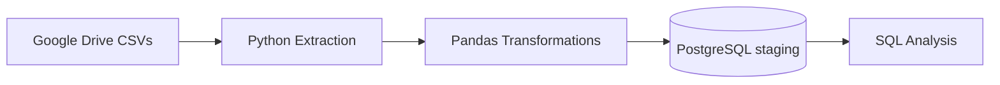

# RandFlow Financial ETL Pipeline

A Python-based **Extract, Transform, Load (ETL)** project that moves banking-style CSV data from **Google Drive** into **PostgreSQL** for analysis and reporting.


## Project Overview

RandFlow demonstrates how to build a small financial data pipeline using the Google Drive API, Python, Pandas, SQLAlchemy, and PostgreSQL. It extracts source files, cleans inconsistent records, calculates signed transaction amounts, and loads the results into a PostgreSQL `staging` schema.

The example data represents customers, accounts, and transactions, with monetary values in South African rand (ZAR).

## Architecture



## Tech Stack

| Technology | Use |
| --- | --- |
| Python | Pipeline orchestration |
| Google Drive API | Cloud file extraction |
| Pandas | Cleaning and transformation |
| SQLAlchemy + psycopg2 | PostgreSQL loading |
| PostgreSQL | Data storage |
| python-dotenv | Environment configuration |
| VS Code, Git, GitHub | Development and version control |
| Docker Compose, Apache Airflow, Metabase | Additional infrastructure files; not yet fully integrated |

## Datasets

| File | Primary identifier | Description |
| --- | --- | --- |
| `customers.csv` | `Customer ID` | Customer profiles, contact details, segments, join dates |
| `accounts.csv` | `Account ID` | Accounts, customer IDs, balances, account statuses |
| `transactions.csv` | `Transaction ID` | Dates, types, amounts, categories, channels, statuses |

**Relationship:** `customers.customer_id` → `accounts.customer_id` → `transactions.account_id` (via `accounts.account_id`).

### Key Transformations

- Standardise column names to `snake_case`.
- Drop fully empty rows and duplicate records.
- Trim whitespace and standardise selected text fields.
- Convert transaction dates and financial amounts into usable types.
- Exclude transactions with missing/invalid dates or amounts.
- Correct negative deposit/refund amounts and derive `signed_amount` for money in/out.
- Add `source_file` and UTC `loaded_at` audit columns.

## Project Structure

```text
RandFlow-Financial-ETL-Pipeline-/
├── src/
│   ├── config.py        # Environment variables and database URL
│   ├── extract.py       # Google Drive API extraction
│   ├── transform.py     # Pandas transformations
│   ├── load.py          # PostgreSQL staging tables
│   └── main.py          # Pipeline entry point
├── dags/
│   └── gdrive-to-postgres.py
├── Dockerfile
├── compose.yml
├── requirements.txt
├── .gitignore
├── LICENSE
└── README.md
```

## Getting Started — Windows CMD / VS Code

### 1. Clone the repository

```cmd
git clone https://github.com/chinweubaudeh/RandFlow-Financial-ETL-Pipeline-.git
cd RandFlow-Financial-ETL-Pipeline-
```

### 2. Create an environment and install dependencies

```cmd
py -3 -m venv .venv
.venv\Scripts\activate.bat
python -m pip install -r requirements.txt
```

### 3. Configure Google Drive and PostgreSQL

Enable the Google Drive API, create a service account with permission to access the source folder, and share the folder with its `client_email` address. Save the JSON key under `credentials/service_account.json` (if your Google Cloud organisation permits service-account keys).

Create a PostgreSQL database and user through pgAdmin or `psql`. Then create `.env` in the project root:

```dotenv
DRIVE_FOLDER_ID=YOUR_GOOGLE_DRIVE_FOLDER_ID
SERVICE_ACCOUNT_FILE=credentials/service_account.json
DB_HOST=localhost
DB_PORT=5432
DB_NAME=finance_db
DB_USER=YOUR_POSTGRES_USER
DB_PASSWORD=YOUR_POSTGRES_PASSWORD
```

Use the folder **ID**, not its entire Google Drive URL. Keep credentials and `.env` out of version control.

If connecting from Windows to the repository's Docker Compose PostgreSQL container, use host port **5434** instead of 5432.

### 4. Run the pipeline

```cmd
python src\main.py
```

The pipeline downloads CSV files, cleans supported fields, and writes to tables such as `staging.customers`, `staging.accounts`, and `staging.transactions`. Check the terminal logs for results or errors.

## Example SQL Queries

**Row counts:**

```sql
SELECT COUNT(*) FROM staging.customers;
SELECT COUNT(*) FROM staging.accounts;
SELECT COUNT(*) FROM staging.transactions;
```

**Net transaction amount by category:**

```sql
SELECT
    category,
    COUNT(*) AS transaction_count,
    ROUND(SUM(signed_amount)::numeric, 2) AS net_amount_zar
FROM staging.transactions
WHERE LOWER(status) = 'completed'
GROUP BY category
ORDER BY net_amount_zar;
```

## Current Status and Next Steps

The **Python Google Drive → Pandas → PostgreSQL** workflow is implemented in the repository. Docker Compose, Metabase, and an Airflow DAG are also present, but the containerised workflow requires corrections before use: the Airflow DAG references `_file_` instead of `__file__`, its invocation expects a `run(raise_on_failure=True)` argument not supported by the current function, the Docker image does not install Airflow, and the Compose `pipeline` service uses the wrong internal PostgreSQL port.

Planned improvements include automated testing, validated relationships, rejected-record tracking, atomic/idempotent loads, incremental processing, working scheduling, and reporting dashboards.

## Security

Do not commit `.env`, Google service-account JSON keys, or real customer/transaction data. Review `.gitignore` before publishing changes.

## License

Distributed under the [MIT License](LICENSE).

## Author

**Chinweuba Udeh** — [GitHub: @chinweubaudeh](https://github.com/chinweubaudeh)
